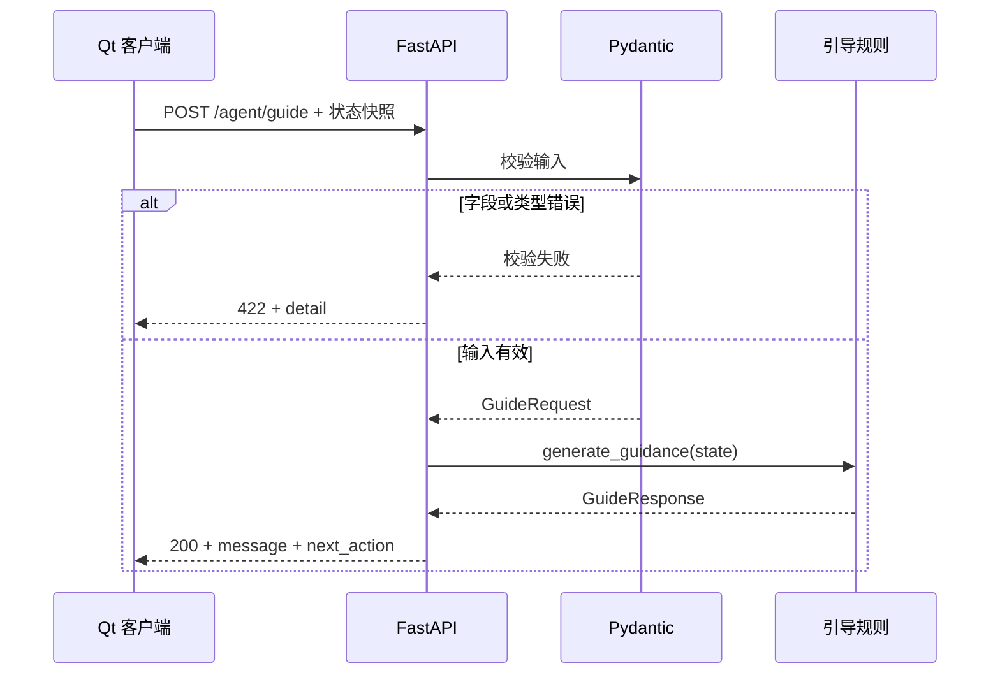

# TAVR Agent Backend 详细设计

版本：0.1.0 / V1。日期：2026-10-10。

## 1. 背景与目标

Qt/C++ 客户端负责影像加载、页面交互及操作结果；Python 后端接收客户端的软件状态，返回可展示的提示及机器可识别的下一步动作。V1 先建立可测试、可解释的 HTTP 边界，为后续知识检索或大模型接入提供稳定入口。

本项目只处理 backend。Qt 接入文档用于联调，实际页面切换需要在桌面项目中实现。产品名为 `tavr-agent-backend`，服务标题为 `TAVR Agent Backend`；不要求现有工作目录重命名。

### 1.1 V1 已实现范围

| 能力 | 交付内容 |
| --- | --- |
| 健康检查 | `GET /health` |
| 软件状态引导 | `POST /agent/guide` |
| 类型与字段校验 | Pydantic 严格输入模型 |
| 确定性规则 | CT → 瓣环定位 → 测量 → 示例完成 |
| 接口说明 | 自动生成 OpenAPI 与 Swagger |
| 自动化验证 | 正常、矛盾、默认及非法状态测试 |

### 1.2 明确不包含的能力

V1 不上传、存储或分析 CT 影像，不读取患者资料，不判断测量准确性，不推荐器械或治疗方案，不自动执行桌面动作。没有大模型调用、会话记忆、数据库、任务队列、账户体系或远程部署基础设施。这里的“Agent”是项目方向命名，当前实现是无状态规则服务。

这些规则仅用于学习软件操作引导，不构成完整或经临床验证的 TAVR 工作流程。完成提示仅表示输入中的三个标志都为 true。

## 2. 主要设计决策

| 问题 | V1 决策 | 原因及影响 |
| --- | --- | --- |
| 谁持有真实状态 | Qt 客户端 | 后端无法验证用户是否实际完成操作 |
| 请求方式 | 每次发送完整状态快照 | 无需服务端会话，便于复现问题 |
| 缺省字段 | 沿用示例默认值 | `{ "state": {} }` 可以演示最初状态；真实客户端仍应发送完整字段 |
| 非法类型 | 422，拒绝隐式转换 | 防止 `"false"`、`1` 等接入错误被掩盖 |
| 未知字段 | 422，拒绝额外字段 | 尽早发现拼写或契约不匹配；新增字段需协调升级 |
| 矛盾状态 | 返回最早未满足的前置步骤 | 保留示例优先级，客户端仍需修正自身状态 |
| 当前页面 | 仅作为上下文传递 | V1 不据此覆盖完成状态，也不限制页面名称枚举 |
| 动作标识 | 有限字符串集合或 null | Qt 可建立明确的白名单映射 |
| 数据存储 | 无 | 避免重复状态和额外维护成本 |
| 初始运行环境 | Python 3.12+，本机回环地址 | 支持现代类型语法，避免依赖 macOS 自带旧 Python |

## 3. 目录与职责

```text
tavr-agent-backend/
├── app/
│   ├── __init__.py
│   ├── main.py                 # FastAPI 实例、路由、接口元信息
│   ├── models/
│   │   ├── __init__.py
│   │   └── schemas.py          # SoftwareState / GuideRequest / GuideResponse
│   └── services/
│       ├── __init__.py
│       └── guidance.py         # 纯规则函数
├── tests/
│   └── test_api.py
├── docs/
│   ├── design.md
│   └── qt-integration.md
├── requirements.txt           # 运行依赖
├── requirements-dev.txt       # 测试依赖，并引用运行依赖
├── pyproject.toml             # 包元信息、Python 要求、测试配置
├── .python-version
├── .gitignore
└── README.md
```

依赖方向为 `main → schemas / guidance → schemas`。规则层不知道 HTTP、Qt 或进程生命周期，可直接复用。V1 只有两个端点，暂不引入多层 router、repository、dependency injection 框架；端点数量或外部依赖增长后再拆分。

## 4. 架构和调用流程



每次调用互相独立。规则函数无 I/O、无副作用，不修改传入状态，不根据历史请求推断进度。HTTP 使用 POST 是因为提交结构化状态，不表示服务端会持久化数据。接口在业务上可以安全重试，同样输入产生同样输出。

当前使用普通 `def` 路由，适合极短的同步规则。以后增加异步外部调用时再使用异步客户端和 `async def`；不要在事件循环中执行阻塞式模型请求或重计算。

## 5. 数据契约

### 5.1 请求外层

Content-Type 为 `application/json`，请求对象必须包含 `state`。外层不允许其他字段。空请求、空对象 `{}`、`state: null` 均不合法。

### 5.2 SoftwareState

| 字段 | JSON 类型 | 默认值 | 语义 |
| --- | --- | --- | --- |
| current_page | string，长度 1–128 | `home` | 客户端页面标识，仅用于上下文 |
| ct_loaded | boolean | false | 客户端认为 CT 已加载成功 |
| annulus_plane_confirmed | boolean | false | 客户端认为瓣环平面已被确认 |
| measurement_completed | boolean | false | 客户端认为测量操作已完成 |

字符串字段不做页面枚举，也不进行去空格处理；客户端应传稳定的非空页面 ID。布尔字段只接受 JSON 布尔值，不接受字符串、数字或 null。额外字段不被静默忽略。

为了兼容教学示例，字段省略时使用保守默认值。这个选择可能掩盖客户端漏传字段，因此联调应核查 Qt 始终发送完整快照。未来若改为必填，需要按不兼容契约升级处理。

### 5.3 GuideResponse

| 字段 | 类型 | 语义 |
| --- | --- | --- |
| message | string | 面向用户的中文操作提示 |
| next_action | string 或 null | 客户端动作标识；null 表示无下一步 |

响应始终包含 `next_action`，完成状态输出 JSON `null`，不会省略字段。客户端逻辑依赖动作值而非中文文案；文案可以在未来调整。

| 动作值 | Qt 侧含义 |
| --- | --- |
| open_ct_import | 展示 CT 导入入口 |
| open_annulus_plane | 展示瓣环定位模块 |
| open_measurement | 展示瓣环测量模块 |
| null | 不执行跳转，可显示完成提示 |

动作仅是建议。后端不控制 Qt，也不保证某模块当前可用。Qt 必须验证动作白名单，并在执行前再次核对当前状态。

## 6. 接口定义

### 6.1 GET /health

无请求体，成功返回 HTTP 200：

```json
{"status":"ok"}
```

只证明服务进程可以处理 HTTP 请求，不证明 Qt 连接、影像状态或未来外部模型正常。新增外部依赖后应区分存活检查与就绪检查。

### 6.2 POST /agent/guide

请求：

```json
{
  "state": {
    "current_page": "ct_viewer",
    "ct_loaded": true,
    "annulus_plane_confirmed": false,
    "measurement_completed": false
  }
}
```

成功返回 HTTP 200：

```json
{"message":"请进入瓣环定位模块。","next_action":"open_annulus_plane"}
```

### 6.3 错误处理

| 情况 | 状态码 / 客户端表现 | 处理方式 |
| --- | --- | --- |
| JSON 格式错误、缺少 state、非法类型或额外字段 | 422 | 修正请求，不自动重试相同错误请求 |
| 路径不存在 | 404 | 检查基础 URL 和接口路径 |
| 请求方法错误 | 405 | 使用规定的 GET / POST |
| 未预期服务异常 | 500 | 客户端提示暂不可用，排查服务日志 |
| 服务未启动、连接拒绝、超时 | 可能无 HTTP 响应 | 显示连接状态，允许重新请求 |

V1 使用 FastAPI 默认校验错误结构 `{"detail": [...]}`。`detail` 内含字段位置、错误类型和说明，具体文本及附加字段可能随依赖版本变化，客户端不应硬编码完整错误文本。未定义自有错误码体系。请求校验失败时不生成 `next_action`。

## 7. 规则和状态一致性

优先顺序固定：先检查 CT，再检查瓣环平面，最后检查测量。`current_page` 不影响决策。

| CT 已加载 | 瓣环已确认 | 测量已完成 | 返回动作 |
| --- | --- | --- | --- |
| false | false | false | open_ct_import |
| false | false | true | open_ct_import |
| false | true | false | open_ct_import |
| false | true | true | open_ct_import |
| true | false | false | open_annulus_plane |
| true | false | true | open_annulus_plane |
| true | true | false | open_measurement |
| true | true | true | null |

前三个矛盾组合及 `true / false / true` 都不报校验错误，而是按最早缺失条件返回建议。这避免“测量完成”掩盖“CT 未加载”，但不会修复客户端状态。

Qt 状态更新建议：载入新 CT 或卸载 CT 时清除平面确认和测量完成标志；修改平面后清除测量完成标志；用户实际确认或计算完成后才设置相应标志。收到跳转建议不等于操作完成，不能直接把标志改为 true。

## 8. Qt/C++ 对接设计

Qt 使用持久的 `QNetworkAccessManager` 异步发送请求，不在 UI 线程等待网络完成。只发送软件状态，不传影像或患者字段。Qt 原生网络请求不依赖浏览器 CORS，V1 无需额外启用跨域中间件。

建议在用户主动请求引导或关键状态发生变化时调用，避免在重绘或高频鼠标事件中请求。状态变化应增加客户端序列号：请求时捕获序列号，响应时仅接受仍与当前状态一致的结果。这防止旧 CT 的响应覆盖新 CT 的页面提示；V1 不把序列号发送到后端。

示例把传输无进展超时设为 3 秒；它不是请求总时限，如需限制总时长，应额外用定时器取消请求。这是客户端体验参数，不是服务性能保证。网络失败可让用户重试；如果未来自动重试，应限定次数、采用退避，并丢弃过期结果。422 不应重试。任何响应都先检查 HTTP 状态、JSON 对象、字段类型和动作白名单。

参考 [Qt 接入示例](qt-integration.md)。示例为 Qt 6 集成片段，未在本后端项目中编译；真实模块跳转由桌面应用接入。

## 9. 运行、依赖与部署

开发环境按 README 创建虚拟环境并启动，开发服务器使用自动重载。Python 3.9 不在本项目支持范围内。运行依赖为 FastAPI（含 standard 启动组件）和 Pydantic；测试依赖为 pytest、HTTPX。运行依赖集中在 `requirements.txt`，包元信息从该文件读取，避免两份运行依赖漂移。

依赖范围不是部署锁文件。正式分发时应在目标平台创建干净环境、验证测试、冻结完整依赖，再用相同依赖部署。Python 次版本和操作系统差异也应纳入发布验证。

本机无重载运行示例：

```bash
python -m uvicorn app.main:app --host 127.0.0.1 --port 8000
```

V1 默认设计为本机联调，无鉴权、限流、请求大小限制或 TLS 配置；回环地址也不等于调用者身份验证。若改为局域网或远程服务，发布工作必须补充认证、传输保护、来源控制、请求限制和运维配置。当前不提供远程部署承诺。

服务没有数据库迁移、持久文件或恢复任务，重启后可以重新接受完整快照。当前只使用服务器常规访问日志，没有业务审计日志。后续增加日志时优先记录请求标识、耗时、状态码和动作类别，避免记录原始请求体或影像信息。监控指标可包括请求数、422/500 比例和响应延迟；本次未实现指标采集。

## 10. 测试策略与验收

`python -m pytest` 使用 FastAPI TestClient，在进程内验证完整的请求校验、路由、规则和序列化。测试不需要启动外部服务，不访问网络或调用模型。

| 验证项 | 预期 |
| --- | --- |
| health | 200，status 为 ok |
| 全部 8 种布尔组合 | 与决策表一致，包括矛盾状态 |
| 空 state | 200，提示导入 CT |
| 错误布尔值、空 state 值、错误页面类型 | 422 |
| 多余字段和拼写错误 | 422 |
| 非法 JSON | 422 |
| 当前页面变化 | 不覆盖操作完成标志 |
| 完成请求后发送初始状态 | 仍返回导入 CT，不残留状态 |
| OpenAPI 与 Swagger | 可以访问，两个端点及必填 state 存在 |

手工联调验收：启动后访问 health 和 docs；发送示例请求并检查动作；将三个标志全部设为 true，确认 next_action 为 null；停止服务后确认 Qt 显示网络错误；连续切换状态时确认旧结果不会应用。最后两项需要真实 Qt 客户端，不能由后端单测替代。

暂未进行负载测试、Qt 可执行程序端到端测试或生产部署测试。不要把本地规则测试通过解释为任何临床验证。

### 本次初始化验证记录

2026-10-10，在 macOS / Python 3.12.14 虚拟环境下，使用 FastAPI 0.143.0、Pydantic 2.14.0、pytest 9.1.1、HTTPX 0.28.1 验证：26 项测试全部通过，`pip check` 未发现依赖冲突，代码语法检查通过。测试运行有 1 条 Starlette 弃用提示：建议将测试传输依赖从 `httpx` 迁移到 `httpx2`；当前 HTTPX 测试仍然通过。本次保留需求中的 HTTPX，后续升级依赖时应处理该迁移并重新验证。

## 11. 演进计划

### 阶段 A：V1 本机联调（本次后端已实现）

交付稳定的输入输出模型、优先级规则、接口文档和测试。下一步在桌面项目中完成动作映射、超时提示和状态序列管理，记录真实接入问题。

### 阶段 B：规则与协议扩展（未实现）

当规则开始分支或需要解释原因时，增加稳定的 `reason_code`、规则版本及可选解释字段；必要时引入明确的流程状态枚举。先确认实际业务流程，再扩大状态模型。当前 `extra=forbid` 意味着客户端不能提前发送新字段，应先升级后端，再更新客户端；删除字段、改变含义或改为必填应发布新契约。

现有端点暂不带版本前缀。出现首个不兼容升级时建议引入 `/api/v2/agent/guide` 并保留原端点过渡，定义兼容期和客户端升级方案。应用版本 `0.1.0` 不自动代表协议兼容承诺。

### 阶段 C：引入知识或大模型（未实现）

把外部模型接入放在独立服务适配层，定义超时、失败回退和结构化输出校验。确定性状态规则继续约束动作范围；模型可以解释操作或回答受支持的问题，不能绕过动作白名单任意执行功能。引入检索前先建立来源、版本和评估样本；不得默认把患者数据发送给外部服务。

只有出现真实需求时再添加会话存储、认证、审计、后台任务和部署流水线。避免在当前三个布尔状态上提前建立复杂的 Agent 编排系统。

## 12. 主要限制及待确认事项

- 三个布尔值无法表达加载失败、处理中、部分完成或测量质量，下一阶段需基于 Qt 实际事件扩展。
- 同一页面可能已打开但操作未完成，V1 仍返回打开该模块的动作；Qt 可显示操作提示而不重复跳转。
- 后端信任客户端快照，不验证状态真实性和用户身份。
- 中文文案固定在规则中；多语言需求明确后再引入文案资源或客户端翻译。
- 是否多用户、是否跨机器、是否需要保存操作历史尚未确认，均不作为已实现能力。

## 13. 参考资料

- [FastAPI 测试文档](https://fastapi.tiangolo.com/tutorial/testing/)
- [FastAPI CLI](https://fastapi.tiangolo.com/fastapi-cli/)
- [Pydantic 模型](https://docs.pydantic.dev/latest/concepts/models/)
- [Pydantic 严格模式](https://docs.pydantic.dev/latest/concepts/strict_mode/)

本文中的产品范围、状态策略与演进方案是本项目设计决策；框架行为以实际依赖版本和自动化测试为准。
